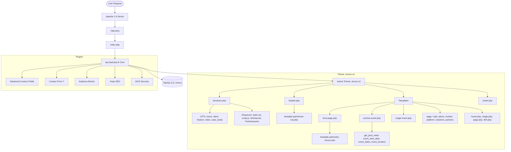

# Project Context & Architecture: Zinvos

> **Primary Knowledge Source**: This file documents the architecture, dependencies, theme structure, custom features, and conventions of the Zinvos WordPress project. AI agents and developers should consult this document first before performing wide project scans or file searches.

---

## 1. Project Overview

- **Project Name**: Zinvos (Conference Technology Platform)
- **Domain / Concept**: B2B Event Management and Technology Platform tailored for medical, academic, scientific, and corporate conferences. Features paperless registration, badge printing, WhatsApp broadcasts, QR check-ins, attendee engagement, and digital certification.
- **Organization / Developer**: Developed by **SPRDH Solutions Pvt Ltd** (`hello@sprdh.com`).
- **Core Site URL**: `http://localhost/sabir/zinvos`
- **Active Theme**: `zinvos-v2` (Standalone custom theme, Version 2.0.0)
- **Legacy Theme**: `zinvos` (Version 1, preserved in repository for reference/legacy asset fallback)
- **E-Commerce**: None (WooCommerce is not installed or used).

---

## 2. Technology Stack

| Layer | Technology | Details |
|---|---|---|
| **CMS** | WordPress | Core version 7.x (WP version string 7.1.2) |
| **Backend Runtime** | PHP | PHP 8.4.1 (CLI / FPM) |
| **Web Server** | Apache 2.4 | Running on Ubuntu (`/var/www/html/sabir/zinvos`), `.htaccess` URL rewrites |
| **Database** | MySQL | MySQL 8.0, DB name `zinvos`, table prefix `wp_` |
| **Frontend Framework** | Vanilla HTML5 / Vanilla CSS / Vanilla JS | **No build step** (no Webpack, Vite, Gulp, or npm package build pipelines) |
| **Styling** | Vanilla CSS (CSS3 Custom Properties) | Located in `wp-content/themes/zinvos-v2/style.css` (~9,500 lines) |
| **Typography** | Google Fonts | `Montserrat` (weights 300 to 900) loaded via Google Fonts CDN |
| **Iconography** | FontAwesome & SVGs | FontAwesome 6.5.1 via CDN + inline SVGs + WordPress Dashicons |
| **Forms** | Contact Form 7 + Native Fallback | CF7 plugin with shortcodes + graceful fallback standalone HTML forms |
| **Security & SEO** | AIOS & Yoast SEO | All-in-One Security & Firewall (`aios-bootstrap.php`), Yoast SEO (`llms.txt`) |

---

## 3. Directory Structure

```text
/var/www/html/sabir/zinvos/
├── docs/
│   └── PROJECT_CONTEXT.md            # Persistent project knowledge (this file)
├── AGENTS.md                         # AI agent instructions & context-first execution rules
├── llms.txt                          # Machine-readable site & entity map (generated by Yoast SEO)
├── wp-config.php                     # WordPress configuration & database connection
├── .htaccess                         # Apache rewrites and acceleration rules
├── wp-admin/                         # WordPress Core admin
├── wp-includes/                      # WordPress Core libraries
└── wp-content/
    ├── plugins/                      # WordPress plugins (ACF, CF7, Yoast, Kadence, etc.)
    │   ├── advanced-custom-fields/   # Custom Fields management
    │   ├── contact-form-7/           # Form processing
    │   ├── contact-form-cfdb7/       # Contact form submissions database storage
    │   ├── kadence-blocks/           # Gutenberg layout blocks
    │   ├── wordpress-seo/            # Yoast SEO
    │   ├── all-in-one-wp-security... # Security firewall
    │   ├── wpcf7-redirect/           # Post-submit form redirect
    │   ├── duplicator/               # Site backup utility
    │   └── wordpress-importer/       # XML content importer
    └── themes/
        ├── zinvos/                   # [LEGACY] V1 Theme (contains legacy templates and submodule)
        └── zinvos-v2/                # [ACTIVE] Current Production Theme
            ├── style.css             # Main stylesheet & CSS Design System tokens
            ├── functions.php         # Theme setup, CPT registrations, hooks, helpers
            ├── header.php            # HTML <head>, body open, includes template-parts/inner-nav
            ├── footer.php            # Global footer, company information, legal notice
            ├── front-page.php        # Homepage template (Hero, Trust, Journey, Events, etc.)
            ├── home.php              # Blog archive listing template
            ├── single.php            # Single blog post template
            ├── page.php              # Default standard page template
            ├── 404.php               # Not found error page template
            ├── archive-event.php     # Event CPT archive listing (Upcoming vs Past sorting)
            ├── single-event.php      # Single Event CPT detailed view
            ├── features-list.php     # Features showcase listing template (queries feature CPTs)
            ├── page-features.php     # Alias template delegating to features-list.php
            ├── single-feature.php    # Single Feature CPT detailed view
            ├── page-about.php        # About page template
            ├── page-about-zinvos.php # Alias template delegating to page-about.php
            ├── page-blog.php         # Custom blog listing page template
            ├── page-contact-us.php   # Contact page template with CF7 shortcode + fallback
            ├── page-contact.php      # Alias template delegating to page-contact-us.php
            ├── page-events.php       # Alias template delegating to archive-event.php
            ├── page-partners.php     # Partnership page template
            ├── page-platform.php     # Platform overview & Access Control template
            ├── page-solutions.php    # Industry solutions template
            ├── js/
            │   └── script.js         # Theme client-side JavaScript (tabs, sliders, navigation)
            ├── images/               # Theme static assets (mockups, SVGs, QR codes, logos)
            ├── template-parts/
            │   ├── inner-nav.php     # Reusable site navigation bar & mobile drawer
            │   ├── why-zinvos.php    # "Why Zinvos" interactive feature showcase
            │   ├── feature-bands.php # Alternating feature presentation bands
            │   └── stories.php       # Case study and customer story layout
            └── *.html                # Static mockup references (partners, platform, solutions)
```

---

## 4. Theme Architecture: `zinvos-v2`

The active theme is **`zinvos-v2`** (`wp-content/themes/zinvos-v2/`). Both `template` and `stylesheet` options in `wp_options` are set to `zinvos-v2`. It is **not** a child theme.

### Key Characteristics:
1. **Zero Build Pipeline**: Styles and scripts are written directly in standard CSS and vanilla JS. No compile or bundle step is required. Changes to `style.css` and `js/script.js` take effect immediately.
2. **Componentized Template Parts**: Navigation is isolated in `template-parts/inner-nav.php`, and reusable marketing sections (like `why-zinvos.php`) are included modularly via `include` or `get_template_part()`.
3. **Graceful Degradation**: Page templates (such as `page-contact-us.php` and `page-partners.php`) evaluate whether CF7 shortcodes render; if not, they output styled fallback HTML forms to prevent broken user experiences.
4. **URL & Template Aliasing**: Slug compatibility files (e.g., `page-about-zinvos.php`, `page-contact.php`, `page-events.php`) require the primary template file to allow multiple WordPress slug configurations without duplicate template code.

---

## 5. Plugin Architecture

| Plugin Slug | Purpose | Impact on Code |
|---|---|---|
| `advanced-custom-fields` | Post metadata schema | Fields for events (`event_start_date`, `event_dates`, `event_location`), home, and features |
| `contact-form-7` | Contact and inquiry forms | Shortcodes embedded in `page-contact-us.php` (`id="080138a"`) and `page-partners.php` (`id="159"`) |
| `contact-form-cfdb7` | Submission database | Stores form submissions in MySQL table `wp_db7_forms` for admin export |
| `kadence-blocks` | Page builder blocks | Used for visual block layout when editing pages through WP admin |
| `wordpress-seo` (Yoast) | SEO meta & sitemaps | Controls canonical URLs, meta descriptions, and generates root `llms.txt` |
| `all-in-one-wp-security-and-firewall` | Security firewall | Manages `.htaccess` security rules and `aios-bootstrap.php` |
| `wpcf7-redirect` | Form redirects | Enables redirection to custom thank-you URLs upon CF7 submission |

---

## 6. Custom Post Types & Taxonomies

Custom Post Types are registered in `wp-content/themes/zinvos-v2/functions.php` on the `init` hook:

| Post Type | Singular | Plural | Archive Slug | Single Rewrite | Supports | Description |
|---|---|---|---|---|---|---|
| `client` | Client | Clients | `client` | `client` | `title`, `thumbnail` | Event clients / brand logos shown in homepage Trust section |
| `feature` | Feature | Features | `feature` | `feature` | `title`, `editor`, `thumbnail`, `excerpt` | Core platform features & capabilities |
| `video` | Video | Videos | `video` | `video` | `title`, `thumbnail` | Video embeds and conference highlight clips |
| `event` | Event | Events | `events` | `event` | `title`, `editor`, `thumbnail`, `excerpt` | Medical & scientific conferences managed on Zinvos |
| `case_study` | Case Study | Case Studies | `case-study` | `case-study` | `title`, `editor`, `thumbnail`, `excerpt` | Comprehensive client conference case studies |

### Taxonomies
- No custom taxonomies are registered.
- Standard WordPress core taxonomies are used: `category` (used for blog posts) and `post_tag`.

---

## 7. Custom Fields (ACF) & REST APIs

### ACF Field Groups (Database-Stored)
ACF field definitions are stored in the WordPress database (post type `acf-field-group` / `acf-field`):
1. **Event Fields** (`group_69099ae48ecc0`):
   - `event_start_date` (`type: text/date`): Format `YYYYMMDD` or `YYYY-MM-DD`. Used by `archive-event.php` and `single-event.php` to classify events as Upcoming or Past.
   - `event_dates` (`type: text`): Human-readable date string (e.g. `"August 20–23, 2026"`).
   - `event_location` (`type: text`): Venue and city (e.g. `"Hotel Radisson Red, Chandigarh"`).
2. **Features Fields** (`group_69c7964fbb2a8`):
   - `icon_color` (`type: text`): Color token (`blue`, `teal`, `green`, `orange`, `pink`).
   - `icon` (`type: image`): SVG or PNG feature icon.
3. **Video Fields** (`group_68b8b3ba22ed2`):
   - `youtube_url` (`type: url`): YouTube video URL for modals and embeds.
4. **Home Page Fields** (`group_68b7fa3632e00`):
   - `hero_title`, `hero_description`, `hero`.

> **Implementation Note**: Theme templates (`archive-event.php`, `single-event.php`) utilize native `get_post_meta($post_id, 'field_key', true)` instead of `get_field()`. This ensures templates render cleanly even if ACF is temporarily deactivated.

### REST API Customizations
- In `functions.php`:
  ```php
  register_rest_field( 'client', 'featured_image_url', array(
      'get_callback' => function ( $object ) { ... }
  ) );
  ```
  Exposes the full featured image URL on the `/wp-json/wp/v2/client` endpoint.
- All CPTs have `'show_in_rest' => true` to support block editor and REST API queries.

---

## 8. Important Templates & Functions

### Key Template Files
- **`front-page.php`**: The central homepage layout.
  - Hero section with dual slideshow faders: desktop event console screens and mobile phone mockup.
  - Dynamic client logo grid queried from `client` CPT.
  - Interactive 5-stage platform journey with SVG cards.
  - Modular include of `template-parts/why-zinvos.php`.
  - Upcoming & past conferences queried from `event` CPT.
  - Recent blog posts row.
  - Final lead generation CTA section.
- **`archive-event.php`**: Event archive.
  - Implements `zinvos_get_event_timestamp( $post_id )` to normalize `YYYYMMDD` and date strings into Unix timestamps.
  - Splits events into `$upcoming` and `$past` relative to `today 00:00:00`.
  - Sorts Upcoming events chronologically (soonest first) and Past events reverse-chronologically (most recent first).
  - Renders event cards via `zinvos_render_event_card( $post, $is_upcoming )`.
- **`single-event.php`**: Single event view displaying status pill (`Upcoming Event` vs `Past Event`), dates, venue location, post thumbnail, full content, and related events.
- **`template-parts/inner-nav.php`**: Fixed/sticky navigation header featuring desktop sub-menus for Platform & Solutions, "Book a Demo" CTA, and responsive hamburger mobile menu drawer.
- **`page-contact-us.php`**: Contact page supporting CF7 shortcode `[contact-form-7 id="080138a" title="Contact Us"]` with automated fallback HTML form.
- **`page-partners.php`**: Partnership landing page with partner intake form `[contact-form-7 id="159" title="Become a Partner"]`.

### Helper Functions in `functions.php`
- `zinvos_v2_setup()`: Theme supports (`title-tag`, `post-thumbnails`, `custom-logo`, `html5`, `automatic-feed-links`) and menu locations (`primary_1`, `top_nav`, `footer_nav`).
- `zinvos_v2_scripts()`: Enqueues Google Font Montserrat, FontAwesome 6.5.1, `style.css`, and `js/script.js` (deferred in footer).
- `reading_time( $post_id )`: Estimates reading time assuming 200 words per minute.
- `zinvos_v2_custom_excerpt_length( $length )`: Forces excerpt lengths to 25 words across archives.
- `zinvos_redirect_event_to_events()`: Hooked to `template_redirect`; issues a 301 permanent redirect for requests targeting `/event` or `/event/` to `/events`.

---

## 9. Frontend Assets & Styling

### CSS Architecture (`style.css`)
The CSS design system is organized into structured sections:
1. **Design Tokens (`:root`)**:
   - Palette: `--ink: #11161a`, `--muted: #68727a`, `--line: rgba(17, 22, 26, .10)`
   - Accents: `--blue: #3189cc`, `--teal: #4aa99c`, `--green: #7ebc2a`, `--orange: #ff9d00`, `--pink: #eb0b59`, `--yellow: #ffc21c`
   - Backgrounds: `--surface: #f7f8f6`, `--surface-2: #eef4f4`, `--surface-3: #e8f2fb`
   - Radius & Shadow: `--radius-xl: 34px`, `--radius-lg: 24px`, `--radius-md: 16px`, `--shadow: 0 30px 80px rgba(24, 43, 55, .12)`
   - Container Max Width: `--max: 1380px`
2. **Namespaced Page Prefixes**:
   - `.ze-*`: Zinvos Events pages (`archive-event.php`, `single-event.php`)
   - `.zp-*`: Zinvos Platform / Partners pages
   - `.zs-*`: Zinvos Solutions pages
   - `.za-*`: Zinvos About pages

### JavaScript Architecture (`js/script.js`)
All client-side behavior is structured in 8 modular blocks wrapped in `DOMContentLoaded`:
1. **Journey Stage Tabs**: Data-driven tab switcher updating eyebrow, title, text, tags, and animated interactive SVG status cards.
2. **Scroll Reveal Animations**: IntersectionObserver adding `.in` classes to `.reveal` elements.
3. **Mobile Navigation Toggle**: Toggles `#inner-mobile-nav` and manages aria attributes on `#inner-menu-btn`.
4. **Smooth Anchor Scrolling**: Handles smooth scrolling with header offset calculation for in-page anchors (`#registration`, `#onsite`, etc.).
5. **Why Zinvos Feature Auto Switcher**: Automated 6-second rotation through features with pause-on-hover and pause on `visibilitychange` (tab hidden).
6. **Partner Form Handler**: Intercepts partner form submissions and displays confirmation.
7. **Contact Form Handler**: Validates inputs and manages success state toggles.
8. **Slideshow Faders**:
   - `phone-slideshow`: Mobile app screenshot cross-fader with dot indicators.
   - `desktop-slideshow`: Hero console desktop screenshot rotator (cycles through `desktop-screen.png`, `desktop-screen-2.png`, `desktop-screen-3.png`).

---

## 10. WordPress Hooks & Filters

### Actions Hooked
| Hook | Callback | Purpose |
|---|---|---|
| `after_setup_theme` | `zinvos_v2_setup` | Registers theme features & menus |
| `wp_enqueue_scripts` | `zinvos_v2_scripts` | Loads styles and scripts |
| `widgets_init` | `zinvos_v2_widgets_init` | Registers `sidebar-1` |
| `init` | `zinvos_v2_register_cpts` | Registers 5 CPTs (`client`, `feature`, `video`, `event`, `case_study`) |
| `rest_api_init` | Anonymous function | Registers `featured_image_url` on `client` REST response |
| `template_redirect` | `zinvos_redirect_event_to_events` | 301 redirects `/event` requests to `/events` |

### Filters Hooked
| Filter | Callback | Purpose |
|---|---|---|
| `excerpt_length` | `zinvos_v2_custom_excerpt_length` | Sets default excerpt length to 25 words |

---

## 11. Common Modification Workflows

When modifying the project, edit these specific files:

| Task | Target File(s) | Notes |
|---|---|---|
| **Add / Edit Custom Post Types** | `wp-content/themes/zinvos-v2/functions.php` | Add in `zinvos_v2_register_cpts()` |
| **Change Header / Navigation Links** | `wp-content/themes/zinvos-v2/template-parts/inner-nav.php` | Both desktop and mobile navigation links are defined here |
| **Modify Site Footer Links / Text** | `wp-content/themes/zinvos-v2/footer.php` | Contact details, copyright, and platform links |
| **Update Color Tokens or Typography** | `wp-content/themes/zinvos-v2/style.css` | Edit `:root` variables at the top of `style.css` |
| **Modify Homepage Hero or Slideshow** | `wp-content/themes/zinvos-v2/front-page.php` & `js/script.js` | Scan images in `wp-content/themes/zinvos-v2/images/` |
| **Adjust Event Filtering or Sorting** | `wp-content/themes/zinvos-v2/archive-event.php` | Modify `$today_ts` or `zinvos_get_event_timestamp()` |
| **Edit Event Detail Layout** | `wp-content/themes/zinvos-v2/single-event.php` | Modify metadata pills, sidebar, or breadcrumbs |
| **Update Contact / Partner Form Shortcodes** | `wp-content/themes/zinvos-v2/page-contact-us.php` & `page-partners.php` | Update CF7 IDs or fallback HTML form fields |
| **Add Client-Side Interactivity** | `wp-content/themes/zinvos-v2/js/script.js` | Add event listeners inside `DOMContentLoaded` |

---

## 12. Architecture Map



---

## 13. Coding Conventions & Best Practices

1. **Escaping & Security**:
   - Always escape output using `esc_html()`, `esc_attr()`, `esc_url()`.
   - Use `wp_trim_words()` when truncating excerpts or titles.
   - Do not write database passwords, salts, or API keys into repository code or documentation.
2. **Metadata Access**:
   - Prefer native `get_post_meta( $post_id, 'meta_key', true )` over ACF helper functions in templates to ensure resilience if ACF is disabled.
3. **No Build Step**:
   - Do not introduce npm build requirements (Webpack, Vite, Tailwind CLI) unless explicitly requested by the user. Edit CSS in `style.css` and JS in `js/script.js`.
4. **CSS Token Reuse**:
   - Leverage established `:root` CSS variables (`var(--blue)`, `var(--teal)`, `var(--ink)`, `var(--surface)`, `var(--radius-lg)`, etc.) rather than hardcoding ad-hoc hex colors.
5. **Asset Linking**:
   - Always reference theme images via `get_template_directory_uri() . '/images/...'`.
   - Check file existence with `file_exists( get_template_directory() . '...' )` before outputting static fallback images or logos.

---

## 14. Unknowns & Verification Notes

- **Database CLI Access**: In local CLI environments, running PHP scripts that connect to MySQL using `localhost` may require specifying the TCP host `127.0.0.1` or the MySQL socket `/var/run/mysqld/mysqld.sock`.
- **ACF Synchronization**: ACF field groups currently reside in the WordPress database rather than local `acf-json` files. If ACF fields are modified in the admin, consider enabling local JSON sync (`acf-json/`) if version-controlling field definitions is desired in the future.
- **Legacy Submodule (`wp-content/themes/zinvos`)**: The v1 theme directory has its own `.git` directory and remains in the workspace. Care should be taken not to unintentionally stage or commit files across both repositories.
